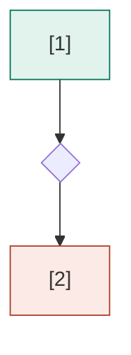

# `ux/user-flow.md` template

Written to `<feature folder>/ux/user-flow.md`. The five numbered headings
are fixed: `check_user_flow.py` finds sections by `## <n>.`, and
`flow_hash` covers sections 1-4 only, so editing open questions never
makes an approved map stale.

```markdown
---
prd: <relative path to the feature prd.md>
feature_id: FEATURE-<slug>
devices: [<mobile | tablet | desktop | kiosk | ...>]
status: draft
approved:
flow_hash: <from `check_user_flow.py hash`>
requirements: [<every live FR- and ERR- ID in the PRD, sorted>]
generated_at: <YYYY-MM-DD>
---

# User flow: <Feature title>

## 1. Flow diagram



## 2. Screens

| # | Slug | Name | Purpose | New/changed | Flow | Requirements |
|---|---|---|---|---|---|---|
| 1 | <kebab-slug> | <Name> | <one line> | new \| changed (<baseline screen>) | <flow slug, ...> | <FR- IDs, or —> |

## 3. Flows

| Flow | Screens | Cases |
|---|---|---|
| <flow-slug> | 1 → 2 → 3, 2 → 4 → 2 | happy, error, edge |

## 4. Transitions

| From | To | Trigger | Condition | Requirement |
|---|---|---|---|---|
| S1 <Name> | D1 <Question> | <user action or system event> | <when, or —> | <FR- or ERR- ID, or —> |

## 5. Open questions

- <question> Assumed: <what the map uses until answered> (<ID it affects>) — <owner>
```

## Field rules

- **`prd`, `feature_id`**: from the resolved PRD.
- **`devices`**: asked once (SKILL.md step 2); `vc-create-ui-mockup`
  reads it instead of asking again.
- **`status`**: `draft` until the user says the PO approved the map. Then
  `approved`, and `approved: <role or name>, <YYYY-MM-DD>`.
- **`flow_hash`**: written last, from `check_user_flow.py hash` on the
  final file. Never computed by hand.
- **`requirements`**: the live `FR-` and `ERR-` IDs in the PRD when the
  map was built (not BR or NFR). The check compares it with the PRD, so a
  later PRD change shows up as a stale map.
- **Screens `#`**: the `[n]` number in the diagram label. Numbers are
  never reused for a different screen once the map is approved; a removed
  screen leaves a gap.
- **New/changed**: `changed` names the existing screen it changes (from
  `docs/design-system/<app>/` baseline boards, or, for a superseding
  feature, the screen in the superseded feature's map).
- **Requirements (Screens)**: full `FR-` IDs the screen serves. An error
  screen may cite the `ERR-` it shows.
- **Requirement (Transitions)**: the `FR-` the move follows, or the
  `ERR-` it leads to. Use `—` for plain navigation (back, cancel).
- **Cases**: which of happy, error and edge the flow covers.
- **Open questions**: each states the assumption the map uses, never an
  invented value presented as decided.
