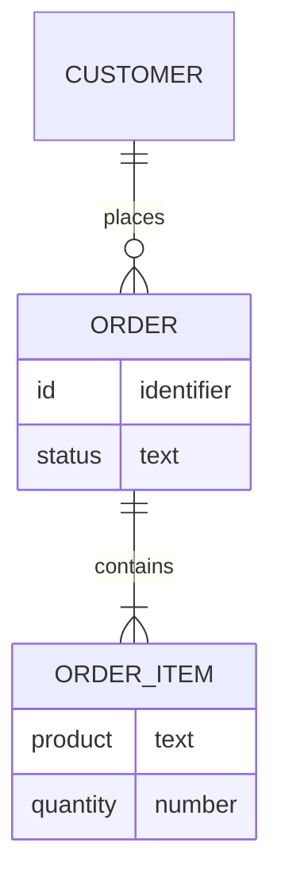

# Checkout - data

## Entity reference

| Entity | Business meaning | Key facts | Label | Source |
|---|---|---|---|---|
| Order | One purchase by one customer | Status is Placed, Shipped or Cancelled | ✅ | `src/shop-api/Domain/Order.cs:3-15` |
| Order item | One product line in an order | Quantity 1 to 99 | ✅ | `src/shop-api/Domain/Order.cs:25` |
| Customer | The signed-in person who places the order | Identified by sign-in name | 🟡 | `src/shop-api/Domain/Order.cs:13` |
