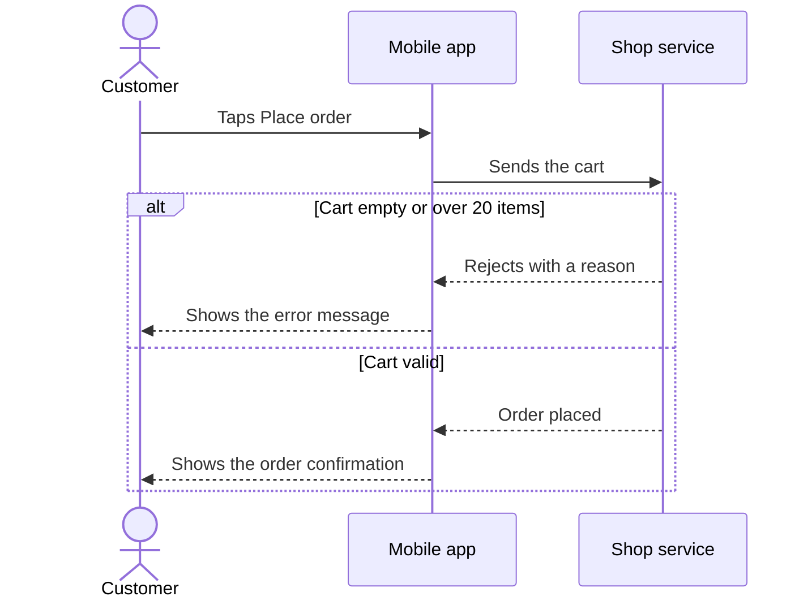
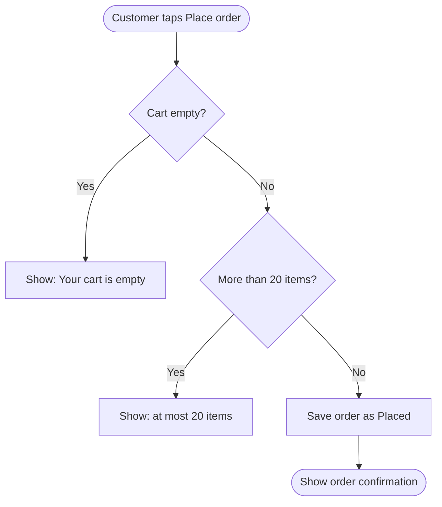
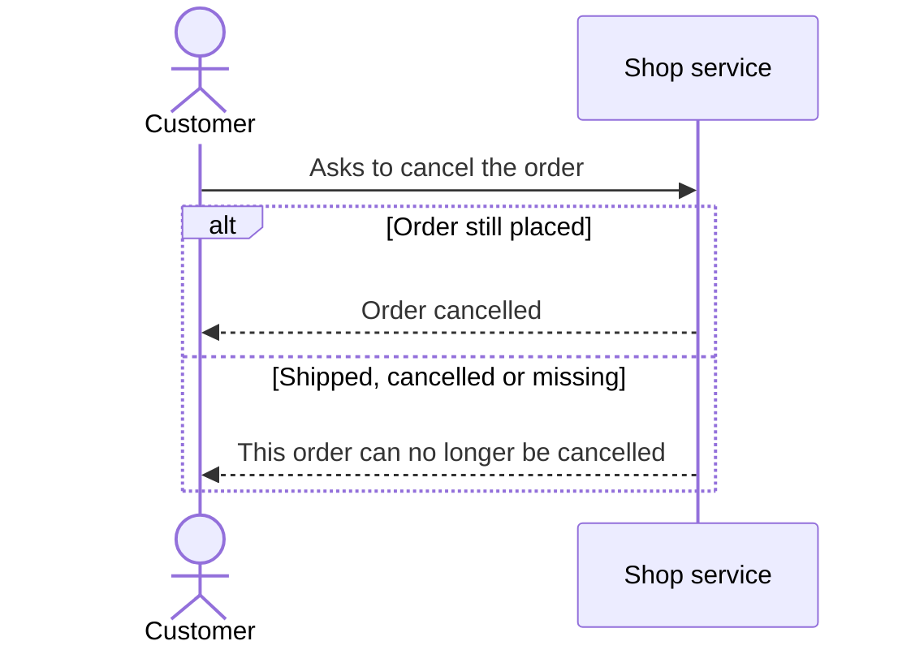
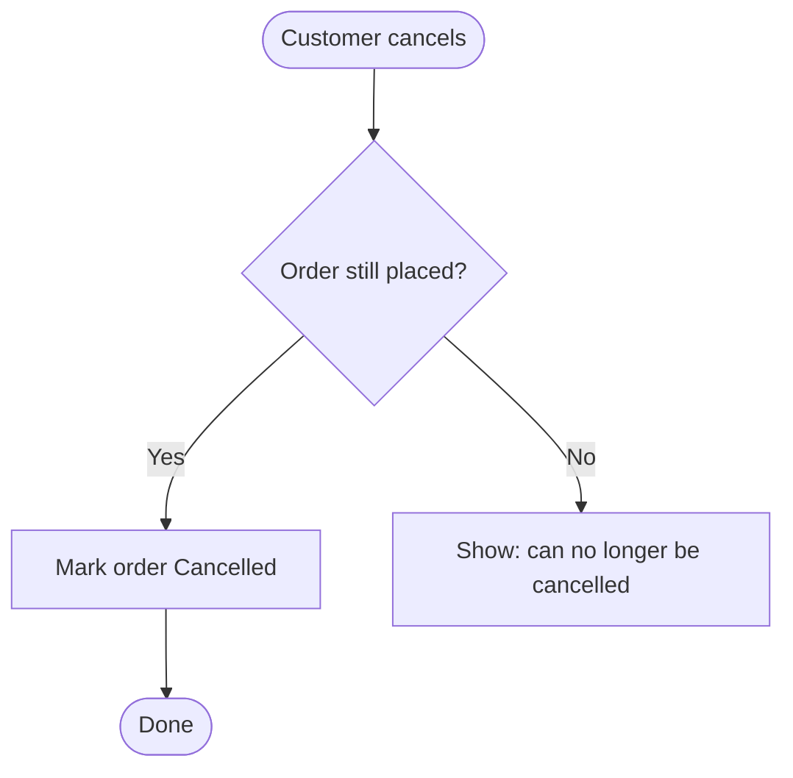

# Checkout - flows

## Flow: place-order

A customer reviews the cart and places an order.

### Sequence

### Activity

## Flow: cancel-order

A customer cancels an order that is still placed.

### Sequence

### Activity

