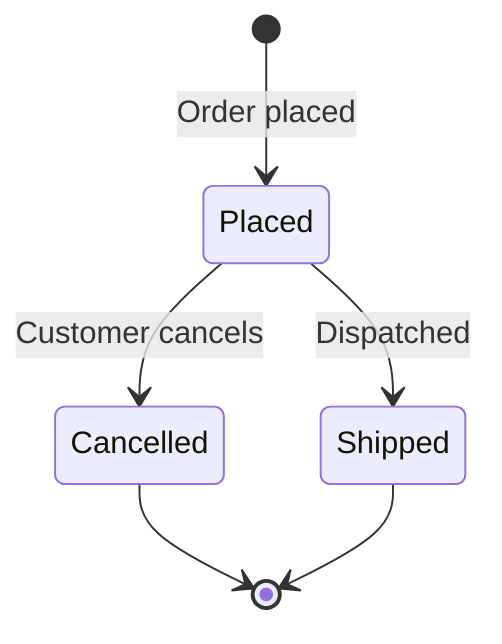

# Checkout - states

## State: Order

| From | To | Label | Source |
|---|---|---|---|
| (new) | Placed | ✅ | `src/shop-api/Domain/Order.cs:15` |
| Placed | Cancelled | ✅ | `src/shop-api/Domain/Order.cs:22` |
| Placed | Shipped | 🔵 | `src/shop-api/Domain/Order.cs:20`, `src/shop-api/Domain/Order.cs:6` |
