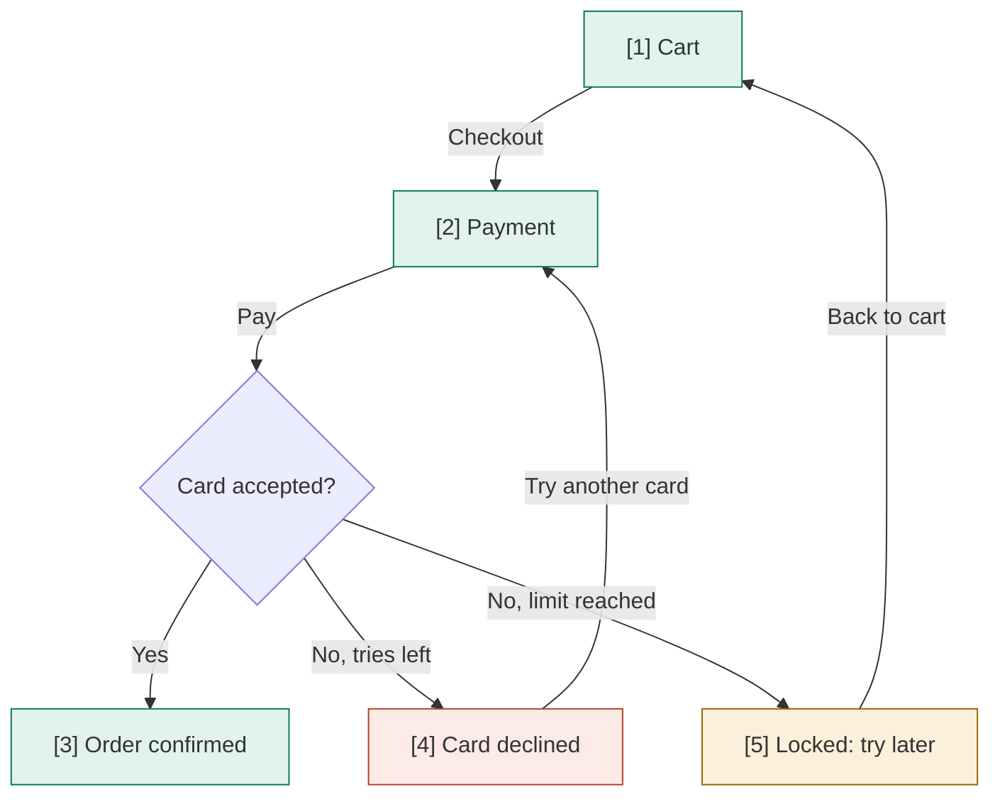

# User flow: Checkout

## 1. Flow diagram

## 2. Screens

| # | Slug | Name | Purpose | New/changed | Flow | Requirements |
|---|---|---|---|---|---|---|
| 1 | cart | Cart | Review items and total | new | pay | FR-checkout.review-cart |
| 2 | payment | Payment | Enter or pick a card | new | pay | FR-checkout.pay-with-card, FR-checkout.save-card |
| 3 | order-confirmed | Order confirmed | Show the order number | new | pay | FR-checkout.pay-with-card |
| 4 | card-declined | Card declined | Explain and offer another card | new | pay | ERR-checkout.card-declined |
| 5 | locked | Locked: try later | Stop retries for 10 minutes | new | pay | ERR-checkout.too-many-tries |

## 3. Flows

| Flow | Screens | Cases |
|---|---|---|
| pay | 1 → 2 → 3, 2 → 4 → 2, 2 → 5 → 1 | happy, error, edge |

## 4. Transitions

| From | To | Trigger | Condition | Requirement |
|---|---|---|---|---|
| S1 Cart | S2 Payment | taps Checkout | cart not empty | FR-checkout.review-cart |
| S2 Payment | D1 Card accepted? | taps Pay | — | FR-checkout.pay-with-card |
| D1 Card accepted? | S3 Order confirmed | bank approves | — | FR-checkout.pay-with-card |
| D1 Card accepted? | S4 Card declined | bank declines | tries left | ERR-checkout.card-declined |
| D1 Card accepted? | S5 Locked: try later | bank declines | 3rd try in 10 minutes | ERR-checkout.too-many-tries |
| S4 Card declined | S2 Payment | taps Try another card | — | — |
| S5 Locked: try later | S1 Cart | taps Back to cart | — | — |

## 5. Open questions

- Does the lock apply per card or per customer? Assumed: per card (BR-checkout.retry-limit).
